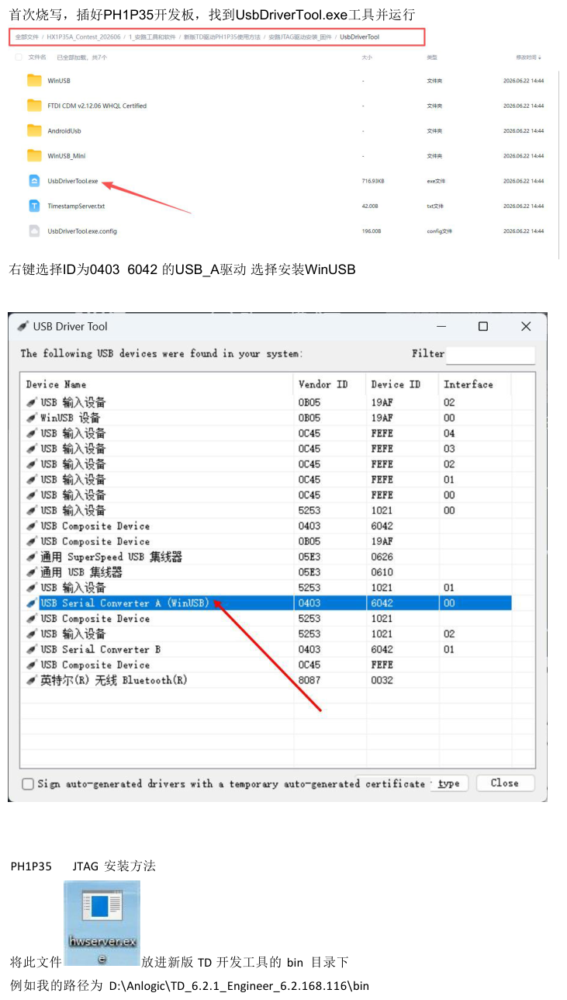
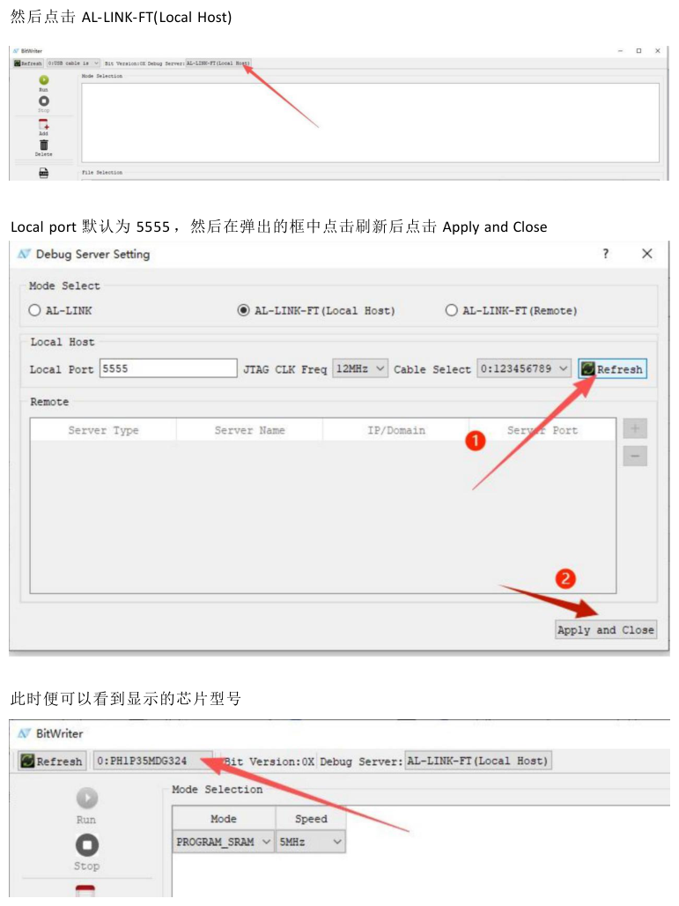
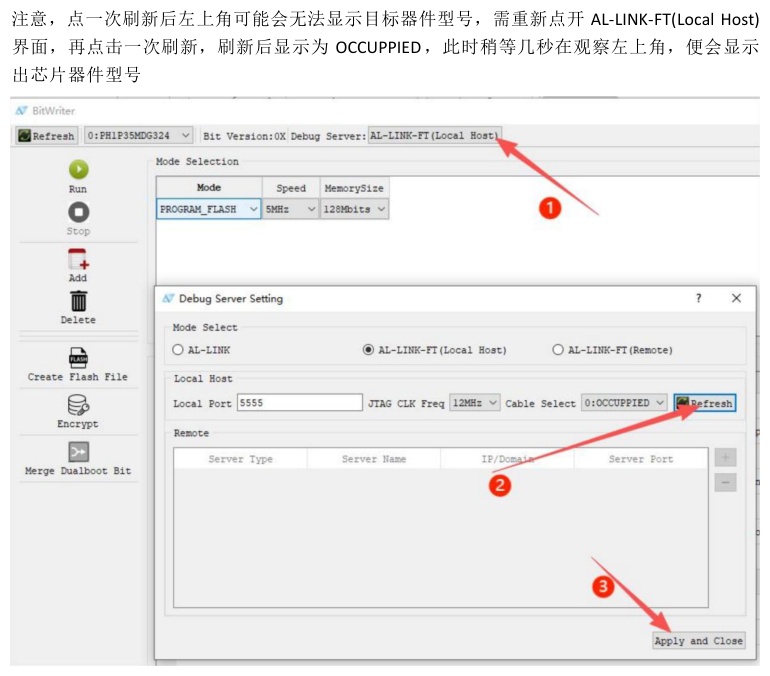

## 一、任务、结果与准备

### 1.1 目标与最终结果

**目标**：把 SC520CS 摄像头的 720p60 实时画面烧进开发板（HX1P35A / PH1P35MDG324），让 HDMI 显示器出图。这是"显示屏显示摄像头所拍画面"的最后一公里。

**最终结果（2026-10-04 实测）**：

| 环节 | 结果 | 证据 |
|---|---|---|
| 下载器识别 | FT2232 A 通道 WinUSB 驱动就绪 | 设备管理器无黄色感叹号 |
| 连接调试服务器 | 127.0.0.1:5555 | `connect_cable` 0.005 秒返回 0 |
| 芯片识别 | **PH1P35MDG324** | `read_device_id` 读回型号 |
| SRAM 下载 | **100% / 11.9 秒**（复烧 11.3 秒） | `PRG-2014 Chip validation success` + 进度条走满 + 返回码 0 |

链路一句话：

```
PC(BitWriter 或 bw 命令行) → hwserver(127.0.0.1:5555) → FT2232 通道A(WinUSB)
→ USB-JTAG 口 → PH1P35MDG324 → SRAM 运行 camera_to_dsi_display
→ HDMI 显示器 = 摄像头实时画面
```

> [!IMPORTANT] 判据提醒
> "下载 100%"证明的是**烧录链路成功**；"显示屏出图"是**功能验收**，要单独看屏确认
> （画面应随摄像头移动而变化）。两者不要混为一谈。

### 1.2 硬件与软件准备

| 项 | 内容 | 注意 |
|---|---|---|
| 开发板 | HX1P35A（芯片 PH1P35MDG324，-3） | 本章实测对象 |
| 摄像头 | SC520CS（MIPI 2-lane，720p60） | FPC 排线按座子丝印方向，勿反插 |
| 显示器 | HDMI，支持 1280x720@60 | 换线排除线材问题 |
| 下载器 | 板载 FT2232（VID 0403 / PID 6042） | A 通道 = JTAG，B 通道 = UART |
| 工具 | 安路 TD 6.2.1（本机 `D:\TD6.2.1`） | BitWriter 与命令行都在 `bin\` |
| 比特流 | `camera_to_dsi_display.bit` | 与原厂 `best_result` MD5 一致 |

接线顺序：**先接显示器与摄像头，再上电源**；下载器插 USB-JTAG 口。板上电后再操作软件。

## 二、一次性前置：下载器驱动安装

**为什么需要**：FT2232 是双通道芯片：B 通道是串口（COMx），A 通道（JTAG）必须先装成 **WinUSB** 驱动，安路工具才能找到它。这是一次性操作，装好后长期有效。

官方步骤（见下图，官方文档《PH1P35烧写程序的使用方法》）：

1. 运行厂商 **UsbDriverTool.exe**（官方工具包 `新版TD驱动PH1P35使用方法\安路JTAG驱动安装_固件\` 下，**需管理员权限**）；
2. 在设备列表里找到并**右键** `USB Serial Converter A`（应显示 Vendor ID `0403`、Device ID `6042`、Interface `00`）；
3. 选择为它**安装 WinUSB 驱动**，按向导完成；
4. 确认 `hwserver.exe` 已放进 TD 的 `bin\`（如 `D:\TD6.2.1\bin\`，官方要求）。

**判据**：装好后 BitWriter 能连上芯片；没装好则报 `PRG-9505 USB device open error`。

> [!NOTE] 为什么设备管理器里"只有 COM4"
> COM4 是 B 通道（UART），它**本来就有**、和下载无关。A 通道装好 WinUSB 后才会作为
> 下载/调试设备出现。看到 COM4 不等于下载器就绪。



## 三、试错全记录（7 个坑：现象 → 根因 → 结论）

### 坑 1：TD 图形界面打不开厂商工程

**现象**：双击厂商工程 `camera_to_dsi_display.al`，TD 报
`PRJ-8641 ERROR: Project file format error: XML tag Project is invalid`，工程打不开。

**已做的修复尝试（全部无效）**：

| 序号 | 尝试的修复 | 结果 |
|---|---|---|
| 1 | 把 57 处裸 `&` 转义为 `&amp;`（`UsedInP&R` 等） | 仍报 PRJ-8641 |
| 2 | 删掉 `<BitgenProperty::GeneralOption>` 属性块（`::` 语法） | 仍报 PRJ-8641 |
| 3 | 删掉 `TD_Encoding` 标签（对照 TD 自产工程唯一顶层差异） | 仍报 PRJ-8641 |
| 4 | 把工程内过期 `Path` 改为实际路径 | 仍报 PRJ-8641 |

**结论**：该 `.al` 与本机 TD 6.2.1 的工程文件格式**不兼容**，属于工程文件问题，
**但不影响已经生成的成品 `.bit`**——烧录完全不受影响。需要重编译时走"新建工程"路线（见附录）。

### 坑 2：设备管理器只出现了 COM4

**现象**：插上下载器后只看到串口 COM4，以为下载器没识别。

**根因**：COM4 是 FT2232 的 B 通道（UART），双通道芯片有两个面孔。

**结论**：JTAG 是 A 通道，需要装 WinUSB（见第二章）；只看 COM 口会误判。

### 坑 3：`PRG-9505 USB device open error`

**现象**：TD/BitWriter 连接时直接报 USB 打开失败。

**根因**：A 通道还在用 Windows 默认的 FTDI 驱动，安路工具无法独占访问。

**结论**：用 `UsbDriverTool.exe` 给 `USB Serial Converter A` 装 WinUSB，装完即解决（管理员权限）。

### 坑 4：`OCCUPIED` 消不掉 —— 两个 hwserver 抢线缆

**现象**：调试服务器 Cable Select 长时间显示 `OCCUPIED`，连不上芯片。

**根因**：手动启动过一个 `hwserver.exe`，而 BitWriter 也会自动拉起一个，两个进程抢同一根线缆。

**结论**：**全机器只允许一个 hwserver**。要么只用 BitWriter 自动拉起的，要么只用手动那个；
发现 `OCCUPIED` 先查任务管理器里 hwserver 实例数。

> [!TIP] hwserver 是什么
> 它是安路工具与下载器之间的本地服务：监听 `127.0.0.1:5555`，真正持有 USB 设备的进程。
> BitWriter（图形界面）和 `bw_commands_prompt.exe`（命令行）都只是它的**客户端**。

### 坑 5：图形界面自动化走不通，转官方命令行

**现象**：尝试用界面自动化脚本代点 BitWriter，反复超时/崩溃（"response lost"）。

**根因**：BitWriter 界面与自动化通道兼容性差。

**结论**：安路官方本来就提供**命令行烧录**（`bw_commands_prompt.exe`），更稳、可脚本化、可复现。
本次最终用命令行完成了烧录（见第五章）——**这不是"歪路"，是官方支持的更快路径**。

### 坑 6：`connect_cable -host ...` 报 invalid option

**现象**：命令行里用 `-host` 连接，被拒绝。

**根因**：参数名不对。

**结论**：正确写法是 **`-host_name 127.0.0.1:5555`**（从 BitWriter 控制台日志里抄到的准确语法）。

### 坑 7：命令缺参数的两连坑

| 现象 | 根因 | 正确写法 |
|---|---|---|
| `download` 报 `PRG-8000 Please specify a bit file` | 少了文件参数 | `download -bit <绝对路径>` |
| `create_flash_file -bit ...` 报 `USR-8011 invalid option -bit` | 选项名不对 | `-target_file <bit>`；`-rom_size` 要带单位如 `16M` |

## 四、正确路线 A：图形界面逐步点击教程

> 每一步给出：**点什么 → 看到什么 → 异常怎么办**。配图为官方文档截图。

### A1. 打开 BitWriter

- **点**：启动 TD 主程序 → 菜单 **Tools → BitWriter**（进程名 `bw.exe`）；
- **看到**：BitWriter 主窗口：顶部 Refresh 与状态文字，左侧竖排按钮（Run/Stop/Add/Delete/Create Flash File/Encrypt/Merge Dualboot Bit），中部 Mode Selection 与 File Selection 两个区域；
- **异常**：窗口没出现 → 多在屏幕外：Win+方向键 或任务栏右键→移动。

### A2. 连接调试服务器（点 AL-LINK-FT(Local Host)）

- **点**：窗口上方 `Debug Server:` 后面的 **AL-LINK-FT(Local Host)** 按钮（下图红箭头(1)处）；
- **看到**：弹出 **Debug Server Setting** 对话框；



### A3. 在弹窗里配置并应用

- **点**：(1) **Refresh**（刷新线缆列表）；(2) **Apply and Close**；
- **看到**：Local Port 显示 `5555`；Cable Select 出现 `0:123456789`；
  Mode Select 选 **AL-LINK-FT (Local Host)**；JTAG CLK Freq 默认即可；
- **异常**：Cable Select 显示 `OCCUPIED` → 见"坑 4"（多个 hwserver 抢线缆）。

### A4. 确认芯片型号（关键一步）

- **看到**：主窗口左上角 Refresh 旁出现芯片型号，例如 **`0:PH1P35MDG324`**；
- **异常（官方已知现象）**：一次 Refresh 可能不显示型号 → 重开 AL-LINK-FT(Local Host) 弹窗
  再 Refresh，短暂显示 `OCCUPIED` 后**等几秒**即出现芯片型号：



### A5. 选择烧录模式

- **点**：Mode Selection 区域的 Mode 下拉 → 选 **`PROGRAM_SRAM`**；Speed 保持 **`5MHz`**；
- **说明**：`PROGRAM_SRAM` 掉电即失（调试用）；固化用 `PROGRAM_FLASH`（见第六章）。

### A6. 添加文件并执行烧录

- **点**：左侧 **Add** → 选 `camera_to_dsi_display.bit`（位于
  `D:\SC520_display_burnpack\01_bitstream_flash_direct\`）；
- **看到**：File Selection 表出现该文件一行 → 点左侧 **Run** →
  "Downloading & Programming" 进度走满 100%（约 12 秒）；
- **验收**：**看显示器**——应出现 SC520CS 摄像头实时画面，移动摄像头画面跟着动；
- **异常**：表里没有文件时 Run 无效；报 `PRG-9505` 回到第二章查驱动。

## 五、正确路线 B：命令行一键烧录（推荐）

**为什么推荐**：不依赖界面；一条命令可复现；能写成脚本双击运行；输出可存档。

### B1. 原理

命令行客户端 `bw_commands_prompt.exe`（在 TD 的 `bin\` 下）连上已经存在的 hwserver
（`127.0.0.1:5555`），执行两条命令即可。hwserver 若没在跑，脚本里先把它拉起来。

### B2. 两条命令

```tcl
connect_cable -host_name 127.0.0.1:5555 -open
download -bit "D:/SC520_display_burnpack/01_bitstream_flash_direct/camera_to_dsi_display.bit"
read_device_id
```

把上面三行存成 `burn.tcl`，然后执行：

```bat
D:\TD6.2.1\bin\bw_commands_prompt.exe burn.tcl
```

### B3. 输出判读（本次实测样例）

```
RUN: connect_cable -host_name 127.0.0.1:5555 -open      → 0.005s, 返回0
RUN: read_device_id                                     → PH1P35MDG324
RUN: download -bit .../camera_to_dsi_display.bit
     PRG-2014 : Chip validation success: PH1P35MDG324
     0%   10   20   30   40   50   60   70   80   90   100%
     ***************************************************    ← 进度条走满
     返回0（DL_R=0）
```

**成功判据 = 三条齐**：`PRG-2014` 出现 + 进度条 100% + 命令返回 0。

> [!WARNING] 会吓人的无害噪声
> 日志里常夹着一行 `Error @ mpsse.cpp:90 : usb_open() failed`——这是客户端退出时
> 重复拉起 hwserver 的报错，**与主链路无关**，不要误判为失败。

### B4. 现成脚本（免手打）

`D:\SC520_display_burnpack\01_bitstream_flash_direct\` 下已备好：

| 脚本 | 作用 |
|---|---|
| `burn_camera_sram.bat` | 烧摄像头画面比特流（本任务主目标） |
| `burn_colorbar_sram.bat` | 烧彩条自检比特流（显示器链路二分定位） |

双击即可：脚本会自动确认/启动 hwserver → 执行连接与下载 → 提示"看显示器"。

## 六、QSPI 固化（断电仍运行）

SRAM 下载掉电即失。比赛/演示需要"**无 PC 参与**"：烧进板上 QSPI Flash，上电自启动。

### 6.1 先读 Flash 型号（决定镜像参数）

命令行执行 `get_flash_manufacturer`，实测输出：

```
Manufacturer ID     : c8
Interface type      : 40
Density and Feature : 18
```

JEDEC ID `C8 40 18` = 兆易创新 **W25Q128**：128Mbit = **16MB** → 固化镜像按 16M 生成。

### 6.2 生成固化镜像（已备好）

```tcl
create_flash_file -target_file "D:/.../camera_to_dsi_display.bit" \
                  -output "D:/.../camera_to_dsi_display_qspi_16M.bin" \
                  -rom_size 16M
```

- 纯本地操作，不需要接板子；
- 本包内已生成好：`01_bitstream_flash_direct\camera_to_dsi_display_qspi_16M.bin`；
- 图形界面对应左侧 **Create Flash File** 按钮（对话框字段：原文件 / 附加文件 / 输出 / rom 大小）。

### 6.3 烧写

- **图形界面**：Mode Selection 选 **`PROGRAM_FLASH`** → Add 固化镜像 → Run；
- **命令行**：`program_spi -mode <1-9> -s ...`（参数格式已探明：`program_spi -mode <mode> -s -output <file> -input <file>`；
  本教程写作时该步尚未执行，首次执行时以工具回显为准）。

### 6.4 冷启动验收（比赛达标线）

1. 烧写完成后：**断电** → 拔掉下载器与电脑连接 → **重新上电**；
2. **15 秒内**显示器出图 = 达标；
3. 再试"只留显示器和板子、完全没有电脑"重新上电，仍出图 = **"无 PC 参与"达标**。

## 七、故障速查总表

| 症状 | 根因 | 处置 |
|---|---|---|
| TD 报 `PRJ-8641 ... XML tag Project is invalid` | 工程文件与本机 TD 版本不兼容 | 用成品 `.bit` 绕行；重编译走新建工程（附录） |
| TD 报 `PRG-9505 USB device open error` | A 通道未装 WinUSB | UsbDriverTool（管理员）给 `USB Serial Converter A` 装 WinUSB |
| 设备管理器只有 COMx，无 JTAG 设备 | 看的是 B 通道（UART） | 正常；A 通道装驱动后才是下载设备 |
| Cable Select 长时间 `OCCUPIED` | 多个 hwserver 抢线缆 | 只留一个 hwserver（推荐让 BitWriter 自拉） |
| 刷一次 Refresh 不显型号 | 官方已知现象 | 重开 AL-LINK-FT(Local Host) 弹窗再 Refresh，等几秒 |
| `download` 报 `PRG-8000` | 缺文件参数 | `download -bit <绝对路径>` |
| `create_flash_file -bit` 报 `USR-8011` | 选项名错 | 用 `-target_file`；`-rom_size` 带单位如 `16M` |
| 日志有 `usb_open() failed` | 重复拉 hwserver 的噪声 | 无害；只认 `PRG-2014` + 100% + 返回 0 |
| 烧完 100% 但显示器无画面 | 可能是摄像头侧或显示器侧 | 先烧 `burn_colorbar_sram.bat` 彩条二分定位 |
| 彩条也不出 | 显示器链路 | 查 720p60 支持、HDMI 线、供电 |
| 彩条出、摄像头画面不出 | 摄像头侧 | 查 FPC 排线方向、摄像头供电、I2C 初始化 |
| BitWriter 窗口找不到 | 跑到屏幕外 | Win+方向键 / 任务栏右键→移动 |

## 八、附录：关键参数与重编译路线

### 8.1 关键参数与产物速查

| 项 | 值 |
|---|---|
| 芯片 | PH1P35MDG324（HX1P35A） |
| 下载器 | FT2232：A=JTAG（WinUSB，VID 0403/PID 6042/Interface 00），B=UART（COMx） |
| hwserver 端口 | 127.0.0.1:5555（本地） |
| Cable Select | `0:123456789` |
| SRAM 模式 | `PROGRAM_SRAM` / 5MHz |
| 下载命令 | `connect_cable -host_name 127.0.0.1:5555 -open`；`download -bit <file>` |
| 实测速度 | 100% / 约 12 秒（1.79MB 比特流） |
| QSPI Flash | 兆易 W25Q128，16MB（JEDEC `C8 40 18`） |
| 固化镜像 | `camera_to_dsi_display_qspi_16M.bin` |
| 比特流身份 | 与厂商 `best_result/camera_to_dsi_display.bit` MD5 相同 |

### 8.2 工程打不开时的重编译路线

厂商 `.al` 打不开不影响使用成品 `.bit`。确需重编译时：

1. 把 `02_TD_project_rebuild\lab_ex1\` 拷到**英文路径**下；
2. TD → **File → New Project**：器件 `PH1P35MDG324`，速度等级 **-3**；
3. 添加源码（与厂商 `.al` 的源列表一致）：
   - `user_source\hdl_source\` 整树（96 个 `.v` + 4 个 `.sv` + 12 个 `.vh` 等）；
   - `user_source\ip_source\`（IP 块，53 个文件）；
   - 约束：`user_source\constraints_source\pin.adc`、`timing.sdc`；
   - 顶层设为 **`design_top_wrapper`**；
4. 跑完整流程 **compile → map → place → route → bitgen** 得到新 `.bit`；
5. 回到第四章（GUI）或第五章（命令行）烧录。

> [!CAUTION] 红线
> - `camera_to_dsi_display_Runs\` 里是厂商成功结果的留档（含 `best_result`），**不要删**；
> - 后续挂视觉模块时：`*_stub.v` / `*_sim.v` 只属于仿真，**禁止加入 TD 工程**；
> - 改代码后重新看时序报告（WNS ≥ 0 再上板）。

---

*本文档所有"实测"数据来自 2026-10-04 现场操作；随包脚本位于
`D:\SC520_display_burnpack\01_bitstream_flash_direct\`。*
