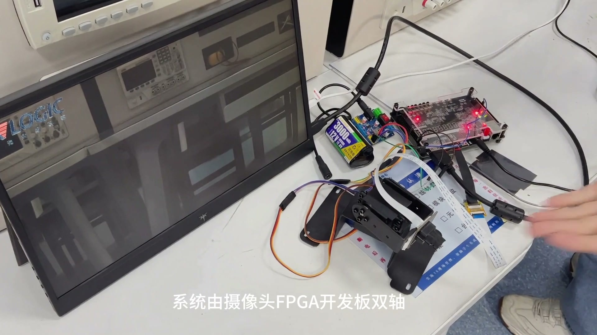

# FPGA视觉处理与云台追踪系统

基于安路PH1P35和SC520CS摄像头的实时视频、红蓝目标追踪与双轴云台系统。

本仓库只维护 **一套最终工程**：2026-11-01的 `view_manual_v17`。完整TD工程位于 [`project/td_project/camera_to_dsi_display.al`](project/td_project/camera_to_dsi_display.al)，顶层为 `design_top_wrapper`。工程沿用原工具项目名，实际输出为 **HDMI**，帧存储为 **DDR2**。



## 实现功能

- 1280×720彩色视频；SC520CS双Lane MIPI RAW10输入，RGB888主链每拍4像素。
- 去马赛克、自动白平衡、饱和度与空间色彩补偿。
- 红/蓝目标选择、目标框、中心坐标、轨迹和全屏坐标轴。
- 线性/S曲线/Gamma灰度，局部自适应二值化；白色边缘叠加、黑白轮廓和卡通。
- 50Hz双轴PWM，中心死区、重启滞回、换向确认与动作分期。
- SW1关闭时保留已生效显示效果，实时视频继续更新，四键改为手动方向控制。

检测分支取白平衡后的彩色数据，位于显示效果之前；切换灰度与边缘不会改变检测输入。目标中心采用所选区域包围框中点。

## 从哪里开始

| 目的 | 入口 |
|---|---|
| 接线、拨码和按键操作 | [硬件与操作](docs/hardware-and-controls.md) |
| 直接下载最终固件 | [构建与下载](docs/build-and-program.md)，`scripts/burn_sram.cmd` |
| 阅读视频、检测与云台设计 | [系统架构](docs/architecture.md) |
| 查看验证数据及边界 | [验证说明](docs/verification.md) |
| 检查源码完整性 | `python scripts/check_repository.py` |
| 查看第三方来源和许可范围 | [第三方声明](THIRD_PARTY_NOTICES.md)、[许可](LICENSE) |

## 目录

```text
project/                 唯一工程
  td_project/            TD入口与时序约束
  user_source/           生产RTL、管脚约束、IP配置与ROM数据
  sim/                   仅依赖当前设计的测试台
  assets/                仿真必需的Logo和字体参考数据
  _build/                验证、综合、布局、导出与运行目录模板
  tools/                 测试向量和字体/ROM辅助工具
firmware/                唯一v17固件、SHA256和原发布清单
scripts/                 下载、测试数据准备与完整性检查
docs/                    使用、设计与验证文档
```

不收录旧版工程、旧位流、历史RTL对照实现、内部原始日志和工具安装包。当前验证入口保留41个只依赖当前生产设计的任务；大型测试向量由脚本生成。

## 开发环境

- Windows；Tang Dynasty 6.2系列，工程记录版本6.2.168116。
- Python 3.10或更新版本，仿真数据生成依赖 `requirements.txt`。
- Icarus Verilog（`iverilog.exe`、`vvp.exe`）；TD及下载器驱动需自行安装。

```powershell
python -m pip install -r requirements.txt
python scripts/check_repository.py
python scripts/prepare_sim.py
$env:SC520_TD_ROOT = 'D:/TD6.2.1'  # 改为自己的TD安装目录
$env:IVERILOG_BIN = 'D:/iverilog/bin'
cd project
python _build/verify_current.py
python _build/build.py syn
python _build/build.py phy 9 0.350
python _build/release_current.py 9
```

以上构建命令不自动烧录。新生成固件位于 `project/outputs/release/`；仓库中的 `firmware/` 固件保留原始发布哈希。

## 最终实现数据

| 指标 | 结果 |
|---|---:|
| Slice | 20068 / 21216，94.59% |
| ERAM | 71 / 108 |
| DSP | 28 / 40 |
| Setup / Hold WNS | +0.250ns / +0.020ns |
| 具名RTL回归任务 | 原发布汇总65项通过；本包提供41项当前设计入口 |

原发布回归包含依赖哈希一致的记录复用，65项不等于65次上板；当前精简包的41项不能冒充已重新执行的65项。演示视频已展示整机功能；机械精度、功耗和端到端延迟尚未量化。详情及对应报告见[验证说明](docs/verification.md)。

## 许可

独立开发内容与新增修改按MIT许可提供；厂商IP、参考例程、原有第三方内容及商标不因此重新授权。保留原版权头，适用范围见[第三方声明](THIRD_PARTY_NOTICES.md)。当前完整工程的第三方再分发授权需由相应权利人许可覆盖。
