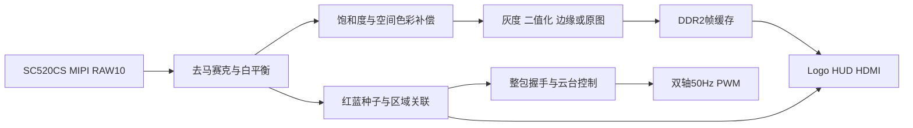

# 系统架构

## 代码入口

所有下列路径相对 `project/user_source/hdl_source/`：

| 文件 | 责任 |
|---|---|
| `design_top_wrapper.v` | 时钟、模式、按键、显示接管、检测与舵机连接 |
| `isp/isp_top.v` | RAW至4像素RGB及检测/显示分流 |
| `awb.v` | 自动白平衡与帧级增益更新 |
| `axis_edge_mode_rgb96.v` | 模式配置、灰度曲线、局部二值化和接管门控 |
| `isp/edge_detect_96.v` | 像素对Sobel、方向一致性和细斜线补偿 |
| `vision_track.v` | 红蓝颜色掩码、瓦片连通与区域关联 |
| `servo/gimbal_center.v` | 死区、追赶、换向和角度命令 |
| `servo/track_servo_ctrl.v` | 新结果资格、自动/手动仲裁和动作分期 |
| `servo/pwm_servo.v` | 双轴PWM输出 |
| `ui_hud_v17_r1.v` | 透明目标信息、坐标轴、轨迹和界面 |

## 检测与控制

颜色特征中V=max(R,G,B)，源码S=max-min，未归一化。红色种子H345～359或0～15，S≥80，V≥60；蓝色种子H200～250，S≥60，V≥40。生长条件更宽，不能把S阈值解释为百分比。

强弱掩码经过3×3多数平滑；32×16瓦片进行区域连接与历史关联，所选区域包围框中点作为中心。显示平滑与舵机输入是不同路径。控制参考中心为(640,360)，每轴±25px停止、偏差超过35px重启；换向确认、分段限步与PWM分期共同限制机械动作。控制不是完整PID。

## 图像效果

局部二值化使用上一完整帧的40×45均值图，经瓦片中心插值形成阈值T=max(4,m-4)，Y>T为白。双bank只在有效完整帧后交换。阈值图未就绪时回退全局阈值。

边缘先形成横向像素对，利用两行历史缓存与当前行建立3×3窗口，生产阈值60。卡通结合黑轮廓与通道量化；该路径不是完整Canny。

空间补偿的验收应使用均匀中性目标，并同时检查真实彩色场景。拍屏照片受显示器和拍摄设备影响，不能直接视作传感器RGB原始测量。
